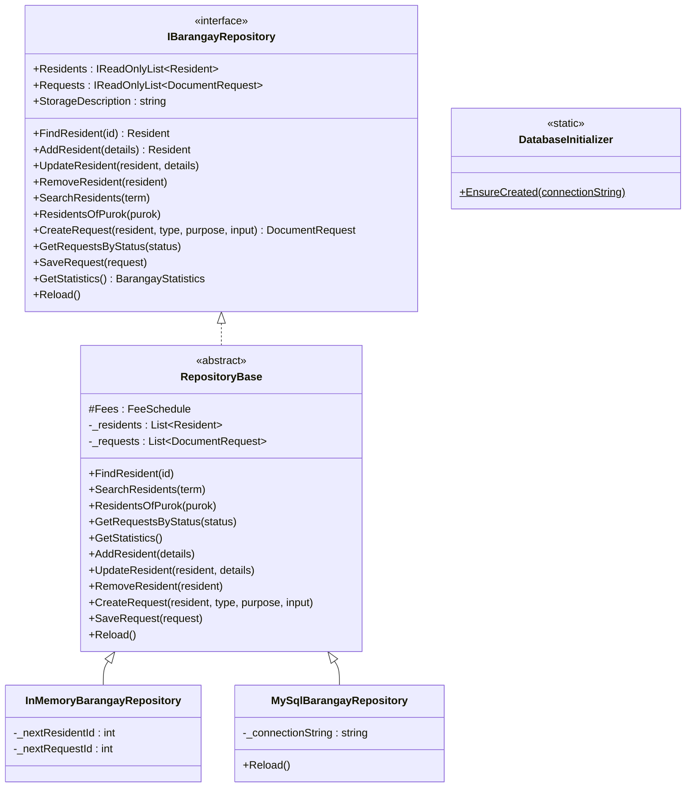
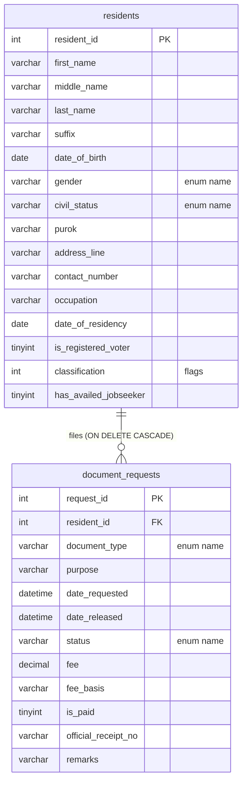
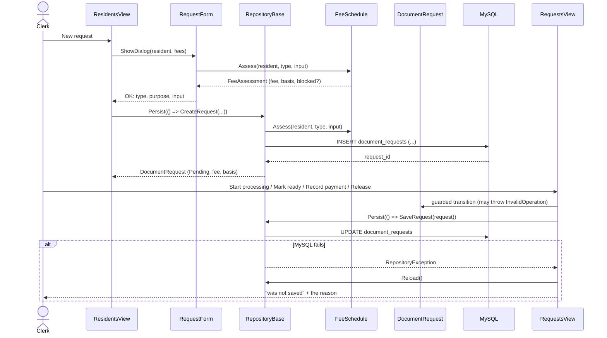

# Object Model — v3.2 (the drafts integrated on the Fdraft baseline)

> **Outdated on purpose.** This document describes the build *before* the
> re-design: the classes and tables below no longer exist in these names
> (`BusinessRules`, `AppSettings`, `MySqlBarangayRepository`, the two-table
> schema). I keep the file because it explains how the group drafts came
> together. For the **current** design, read `docs/11-revamp-notes.md` and
> the folder map in the README; the current database scripts are in
> `BarangayDocumentSystem/Database/Scripts/`.

*Written by Clint Wood Gado.* This is the object-oriented model I built the
v3.2 code from: which classes existed, what each one was responsible for,
how they related, and where each SOLID and DRY decision lived. Diagrams are
Mermaid, so GitHub renders them and they can be updated with a text editor.

---

## 1. The layers (v3.2)

```text
 Views / Forms / CustomControls            what the clerk sees
        │  depend only on
 Interfaces  (IBarangayRepository, IDocumentTemplate, RepositoryException)
        │  implemented by                          ▲ used by
 Database   (RepositoryBase → InMemory | MySql)    BusinessRules (FeeSchedule, templates, renderer)
        │  both work on                            │
 Models     (Resident, DocumentRequest, RequestInput, enums, BarangayProfile)
```

The arrow of dependency always points inward. A screen never named the
MySQL repository; `Program.cs` was the only file that did. That rule
survived the re-design unchanged — only the class names moved
(`Data/Sql/SqlBarangayRepository`, `Config/AppConfig`).

---

## 2. Class diagram — persistence (v3.2)



**Template Method.** The base owned the skeleton of every command:
validate → persist (hook) → mirror in the working set. The in-memory
repository's hooks handed out counter ids; the MySQL repository's hooks
ran the parameterised SQL. The re-design keeps this idea, but the SQL
repository now talks to the database directly per operation instead of
holding a mirrored working set.

---

## 3. Entity–relationship model (v3.2)



Two tables, Frent's design, storing enum *names* never numbers — that
convention survived. The re-design grew this into eight tables (residents,
dependents, document_requests, request_status_history, receipt_series,
official_receipts, user_accounts, activity_log, reference_counters); see
`BarangayDocumentSystem/Database/Scripts/MySql/01-schema.sql` for the
current, authoritative schema.

---

## 4. Sequence — filing a request through to release (v3.2)



---

## 5. Where SOLID and DRY actually were

I only claimed a principle where a file demonstrated it.

| Principle | Where (v3.2) | What would break it |
|---|---|---|
| **S**ingle responsibility | `FeeSchedule` priced; `DocumentRequest` guarded state; the repository stored; the renderer laid out; the settings class read config | a fee amount typed into a form; a status set from a screen |
| **O**pen/closed | a new document = one `IDocumentTemplate` class + one enum value; a new storage = one `RepositoryBase` subclass | a `switch` on document type inside the renderer |
| **L**iskov substitution | the in-memory and MySQL repositories were interchangeable behind `IBarangayRepository`; the RuleChecks harness ran the same rules on the in-memory one | a storage whose save silently dropped changes |
| **I**nterface segregation | `IBarangayRepository` (storage), `IDocumentTemplate` (one document) — no screen depended on SQL types | a MySQL connection type on the interface |
| **D**ependency inversion | screens and forms received the repository and fee schedule through constructors; `Program.cs` was the composition root | `new MySqlBarangayRepository()` inside a view |
| **DRY** | one apply, one search, one statistics, one sample-data seeder, one grid styler, one config reader, one schema, one palette | the same seven residents typed into two seeders |

Every one of these principles is still in force in the re-designed code;
the names moved, the ideas did not.
